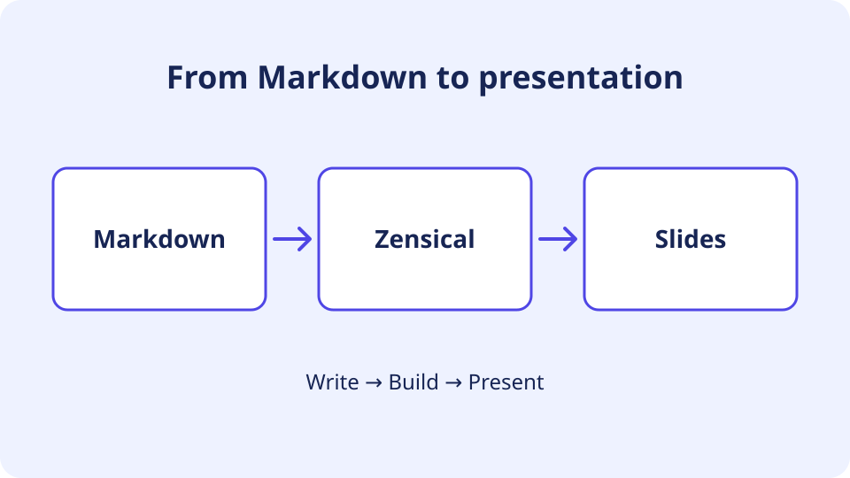

# An image on the right

- Write your **Markdown** text first.
- Add the marker, then the image.
- Lead with a heading and a few points.

Choose the column order in the source.

<!-- column-break -->

