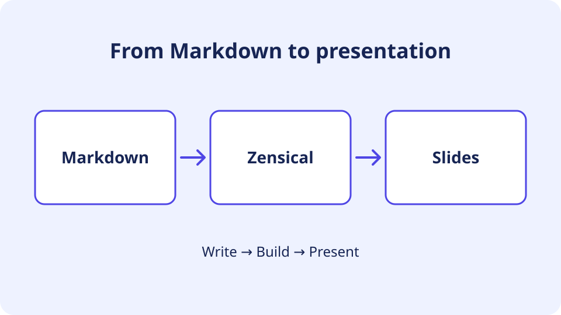

# An image beside Markdown



<!-- column-break -->

Separate the columns with this marker:

```
<!-- column-break -->
```

- Put the image before the marker.
- Write the explanation in **Markdown** after the marker.
